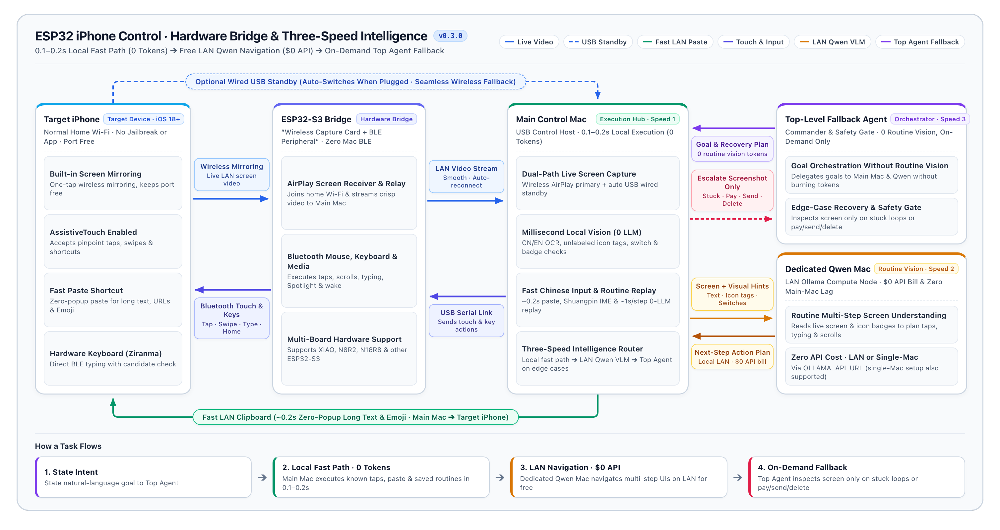

# ESP32 iPhone Control

[简体中文](README.md) · English

<p>
  <a href="LICENSE"></a>
  
  
  
  
</p>

**ESP32 iPhone Control** is a zero-jailbreak, zero-app-install physical iPhone automation system. An inexpensive ESP32-S3 board bridges wireless screen mirroring and Bluetooth touch/keyboard control to a Main Control Mac, working together with a LAN-hosted Qwen vision model and a top-level fallback Agent so AI can read the screen, tap accurately, type smoothly in Chinese and English, and run daily mobile workflows reliably at minimal cost.

---

## How It Works: Environment & Role Division

Traditional AI phone automation faces an awkward trade-off: sending every screenshot to a cloud frontier model takes 3–8 seconds per tap and burns vision tokens, while relying solely on a small local model is free but easily stalls on unexpected popups or dense layouts.

This project uses a **"Hardware Non-Intrusive Bridge + Three-Speed Intelligence"** architecture: deterministic screen perception and touch execution happen in milliseconds on the Main Control Mac, routine multi-step UI navigation runs for free on a dedicated LAN Qwen Mac, and your top-level frontier Agent (Claude / Gemini / Antigravity) steps in to inspect screenshots **only** when something unexpected or sensitive happens.

### System Layers & Roles

- **📱 Target Device · iPhone (iOS 18+)**
  An everyday iPhone staying on your normal home Wi-Fi. No jailbreak, developer signing, or custom test app is required — simply enable built-in **Screen Mirroring** and **AssistiveTouch** while keeping full internet access and leaving the charging port completely free.

- **🔌 Hardware Bridge · ESP32-S3 Bridge**
  A "wireless capture card + Bluetooth peripheral" bridging your iPhone and Mac. It joins your home router to receive AirPlay screen mirroring and relay live frames to the Main Mac, while simultaneously emulating a Bluetooth mouse, keyboard, and media keys (taps, swipes, typing, Spotlight, Home, and lock/wake) — with zero Mac Bluetooth usage.

- **🖥️ Perception & Execution Hub · Main Control Mac**
  The USB-connected command center driving the ESP32-S3. It ingests the live wireless stream (or optional wired USB standby), runs local CN/EN OCR, auto-numbers unlabeled icons, checks ON/OFF switches and unread red badges, and handles ultra-fast Chinese input (LAN clipboard paste and Ziranma Shuangpin candidate verification). Actions like tapping a text label, launching an app, or replaying saved routines finish locally in **0.1–0.2s** without waking any LLM.

- **🧠 Routine Vision Brain · Dedicated Qwen Mac (LAN Ollama Node)**
  A second Mac on the LAN dedicated to running Qwen multimodal vision models via `OLLAMA_API_URL` (or co-located on the same machine if you only have one high-spec Apple Silicon Mac). It handles day-to-day screen understanding, multi-step navigation, and scrolling locally at **zero API fees**, keeping heavy VLM inference off the Main Mac so live viewing and touch responsiveness never lag.

- **🛡️ Orchestrator & Safety Net · Top-Level Fallback Agent (Claude / Gemini / Antigravity, etc.)**
  The "commander-in-chief" and "safety gatekeeper" that talks with you and breaks down complex goals. Normally it only dispatches goal instructions to the Main Mac with **zero routine vision token cost**; only when the local Qwen model hits an unfamiliar layout, triggers the stuck-screen circuit breaker, or reaches a sensitive step (**payments, sending messages, or deleting data**) does it pull a live screenshot on demand to troubleshoot or ask for your confirmation.

### How a Task Actually Flows

1. **State Your Intent**: Give the top-level Agent a natural-language goal (e.g., *"Check Bluetooth status in Settings, then jot down a reminder in Notes"*).
2. **Fast Local Path (0 Tokens)**: Known app launches, explicit text taps, long-text pastes, and saved routines execute locally on the **Main Control Mac** in ~100–200ms.
3. **Free LAN Navigation ($0 API Bill)**: Whenever a screen requires visual judgment to pick the next tap or scroll, the **Main Control Mac** sends the frame with OCR and numbered icon hints to the **Dedicated Qwen Mac** to advance the loop locally.
4. **On-Demand Fallback (Safe & Reliable)**: If everything succeeds, it simply reports back; only on consecutive-failure circuit breaks or sensitive actions (pay / send / delete) is a screenshot escalated to the **Top-Level Fallback Agent** to take over or confirm with you.

---

## Architecture

<p align="center">
  
</p>

---

## What It Can Do

- **Zero Jailbreak, Zero App Install, Normal Wi-Fi Online**
  Uses built-in iOS Screen Mirroring and AssistiveTouch on normal home Wi-Fi — no Xcode signing, TestFlight, or developer certificates required, and the iPhone charging port stays free.
- **Pinpoint Taps & Full Device Gestures**
  Full-screen absolute positioning (auto-calibrated in seconds with no cursor drift) delivers **~0.2s** taps, rapid multi-taps, smooth scrolling/swiping, Home, Spotlight app launch, and one-tap soft-keyboard toggling.
- **Crisp, Stable Live Screen (Wireless + Wired Hot-Standby)**
  Delivers a smooth, glitch-free wireless screen stream with automatic reconnect recovery. When a USB cable is plugged in, wired screen capture takes over automatically, and seamlessly hands back to wireless AirPlay when unplugged.
- **Reads Text, Unlabeled Icons, Switches & Notification Badges**
  Millisecond full-screen Chinese/English text recognition lets you tap directly by text; unlabeled UI icons (back `<`, close `×`, search 🔍, add `+`, settings gear ⚙️) automatically get numbered visual badges for accurate clicking; ON/OFF switches and unread red badges are read locally with zero LLM tokens.
- **Smooth Chinese, Long Text & Emoji Input**
  Paste long paragraphs, URLs, multiline text, and Emoji in **~0.2s** over LAN with zero iOS popup prompts. For native keyboard typing, Ziranma Shuangpin visually checks and selects the right candidate word from the iOS candidate bar.
- **Tiered Cost-Saving Collaboration, Self-Recovery & Rapid Workflow Replay**
  Local fast actions run directly on the Main Mac, multi-step navigation runs free on the LAN Qwen Mac, and the top-level Vision Agent steps in only for stuck recovery or sensitive confirmations (`confirm` before paying, sending, or deleting). Verified workflows can be saved with one command and replayed at **~1s/step** with zero LLM calls, falling back cleanly if an unexpected popup appears.

---

## Quick Start (macOS + ESP32-S3)

### 1. Build & Flash ESP32-S3 Firmware

Configure your home Wi-Fi credentials in `hardware/hid_bridge/secrets.h` (gitignored):

```bash
cp hardware/hid_bridge/secrets.example.h hardware/hid_bridge/secrets.h
# Edit hardware/hid_bridge/secrets.h with your WIFI_SSID and WIFI_PASS
```

Install the ESP32 core and NimBLE library, then flash your board (supports default OPI PSRAM, QSPI boards like N8R2, and N16R8):

```bash
arduino-cli core update-index --additional-urls https://espressif.github.io/arduino-esp32/package_esp32_index.json
arduino-cli core install esp32:esp32@3.3.12 --additional-urls https://espressif.github.io/arduino-esp32/package_esp32_index.json
arduino-cli lib install "NimBLE-Arduino@2.5.1"

# Default (e.g., Seeed XIAO ESP32S3, 8MB Flash + 8MB OPI PSRAM):
hardware/flash.sh --sta

# ESP32-S3-WROOM-1 N8R2 / N4R2 (2MB QSPI PSRAM):
hardware/flash.sh --sta --qspi

# ESP32-S3 N16R8 (16MB Flash + 8MB OPI PSRAM):
hardware/flash.sh --sta --16m
```

**On your iPhone (iOS 18+):**
1. Pair **`ESP32 Agent XXXX`** in **Settings → Bluetooth**.
2. Enable **Settings → Accessibility → Touch → AssistiveTouch**.
3. If using Ziranma Shuangpin typing (`type_zh`), set the hardware Chinese Pinyin keyboard layout to **自然码双拼**.
4. Open **Control Center → Screen Mirroring → `ESP32 Agent`**.

### 2. Compile Native macOS Helpers on the Main Control Mac

```bash
swiftc -O screen_ocr.swift -o screen_ocr
swiftc -O usb_capture.swift -o usb_capture   # optional: wired USB screen capture standby
swiftc -O vt_decoder.swift -o vt_decoder     # optional: standalone hardware video decoder
```

### 3. Install Python Dependencies & Configure `.env`

```bash
pip install pyserial av Pillow
cp .env.example .env
```

On the Mac running Qwen inference (either your Dedicated Qwen Mac on LAN, or the same Mac for single-Mac setups), install Ollama and pull the vision model:

```bash
ollama pull qwen3.5:4b
```

Edit `.env` on the Main Control Mac (auto-loaded by `iphone_ctl.py` and `iphone_agent.py`):

| Variable | Default / Example | Description |
| :--- | :--- | :--- |
| `ESP32_SERIAL_PORT` | Auto-discovered `/dev/cu.usbmodem*` | Pin a specific ESP32-S3 USB serial port if needed |
| `OLLAMA_API_URL` | `http://127.0.0.1:11434/api/chat` | Qwen inference endpoint: point to your **Dedicated Qwen Mac** on LAN (e.g., `http://192.168.x.x:11434/api/chat`), or keep `127.0.0.1` for single-Mac deployment |
| `OLLAMA_MODEL` | `qwen3.5:4b` | Local Qwen vision-language model name |
| `IPHONE_CLIP_PORT` | `8766` | LAN fast clipboard service port |
| `IPHONE_PASTE_TRIGGER` | `btn:3` | Trigger for `AgentPaste` (`btn:2..5`, `key:ctrl+alt+v`, or `pbcopy`) |

> **Tip**: When running Qwen on a dedicated Mac on your LAN, start Ollama on that machine with `OLLAMA_HOST=0.0.0.0` so it accepts LAN requests, and set `OLLAMA_API_URL=http://<Qwen_Mac_LAN_IP>:11434/api/chat` in `.env` on the Main Control Mac.

### 4. Start Video & Fast Paste Daemons

```bash
# Check serial, Bluetooth link, and board status
python3 iphone_ctl.py status

# Start wireless screen stream daemon (continuously updates live frame)
python3 iphone_ctl.py daemon

# Start LAN fast clipboard service (for zero-popup long text & Emoji paste)
python3 iphone_ctl.py clip_serve

# Optional: start wired USB capture standby (auto-yields wireless when plugged)
python3 iphone_ctl.py usb_daemon
```

**iPhone `AgentPaste` 3-Step Setup:**
Open `http://<Main_Mac_IP>:8766/setup` in Safari on your iPhone:
1. Create a Shortcut named **`AgentPaste`** with 2 actions: **Get Contents of URL** (`http://<Main_Mac_IP>:8766/clip`) → **Copy to Clipboard** (enable **Local Only**).
2. In **Settings → Accessibility → Touch → AssistiveTouch → Devices**, select the ESP32 mouse and map **Button 3** to **`AgentPaste`**.
3. Run the shortcut once to grant local network permission.

### 5. Common Commands & Agent Examples

```bash
# Optional first-time auto calibration for pinpoint full-screen taps
python3 iphone_ctl.py calibrate_abs

# Fast local controller commands on the Main Mac (0 LLM calls)
python3 iphone_ctl.py screenshot /tmp/snap.jpg
python3 iphone_ctl.py abstap 0.50 0.52
python3 iphone_ctl.py tap_aim 360 800
python3 iphone_ctl.py spotlight 备忘录
python3 iphone_ctl.py paste "Long text + Emoji 🚀🎉 pasted in ~0.2s over LAN!"
python3 iphone_ctl.py type_zh "自然码双拼闭环候选词校验测试通过"
python3 iphone_ctl.py kbd_toggle
python3 iphone_ctl.py home

# Local recognition & multi-step agent tasks (Local -> LAN Qwen -> Top-Level Fallback)
python3 iphone_agent.py ocr
python3 iphone_agent.py tap_text "无线局域网"
python3 iphone_agent.py goal "打开设置，进入蓝牙页面并汇报当前蓝牙开关状态"

# Save & replay recurring workflows at ~1s/step with 0 LLM calls
python3 iphone_agent.py intent_save check_bluetooth
python3 iphone_agent.py intent_run check_bluetooth
```

---

## Repository Layout & Tests

```text
iphone_ctl.py       Main Mac controller: USB-serial bridge, wireless/USB screen daemon, taps & fast input
iphone_agent.py     Tiered GUI agent: local OCR/icons/switches, LAN Qwen planning, fallback & workflow replay
clipboard_http.py   LAN HTTP clipboard mailbox server for zero-popup ~0.2s paste
som_grounding.py    Unlabeled icon detector and numbered badge renderer
ziranma.py          Chinese word segmenter & Ziranma Shuangpin encoder
screen_ocr.swift    Native macOS fast CN/EN text recognition helper
usb_capture.swift   Native macOS wired USB screen capture standby daemon
vt_decoder.swift    Optional standalone macOS hardware video decoder helper
tests/              Offline unit test suites (no physical hardware required)
hardware/           ESP32-S3 bridge firmware and host C tests
assets/             Bilingual architecture diagrams (architecture-zh.png, architecture-en.png)
.env.example        Template for serial port, Qwen Ollama URL & clipboard config
```

Run offline tests (no physical hardware required):

```bash
# Python host-side unit tests
python3 -m unittest discover -s tests -v

# ESP32 firmware pure-C core tests (requires mbedtls 3.x)
make -C hardware/tests test
```

---

## License & Acknowledgments

- **Main License**: Host-side controller, GUI agent, and extensions in this repository are licensed under the **MIT License** (`Copyright (c) 2026 jlcbk`). See [`LICENSE`](LICENSE) and [`NOTICE`](NOTICE).
- **Upstream Attribution**: Based on [ESP32 iPhone Agent](https://github.com/onehumanbeing/esp32-iphone-agent) by Henry Yuan.
  The ESP32 AirPlay receiver and BLE/USB HID bridge firmware under `hardware/` is adapted from and built on Henry Yuan's **[ESP32 iPhone Agent](https://github.com/onehumanbeing/esp32-iphone-agent)** (`Copyright (c) 2026 Henry Yuan`, MIT License). Keep the copyright notices and `LICENSE`/`NOTICE` in any copy or derivative work, and visibly credit **ESP32 iPhone Agent by Henry Yuan** in READMEs as well as public demos, videos, or posts.
- **GPL-3.0 Component (`hardware/hid_bridge/src/airplay/`)**: Ported from [UxPlay](https://github.com/FDH2/UxPlay) and licensed under **GPL-3.0** (see [`hardware/hid_bridge/src/airplay/LICENSE-GPL.md`](hardware/hid_bridge/src/airplay/LICENSE-GPL.md)); compiled firmware binaries linking this component are distributed under GPL-3.0.
