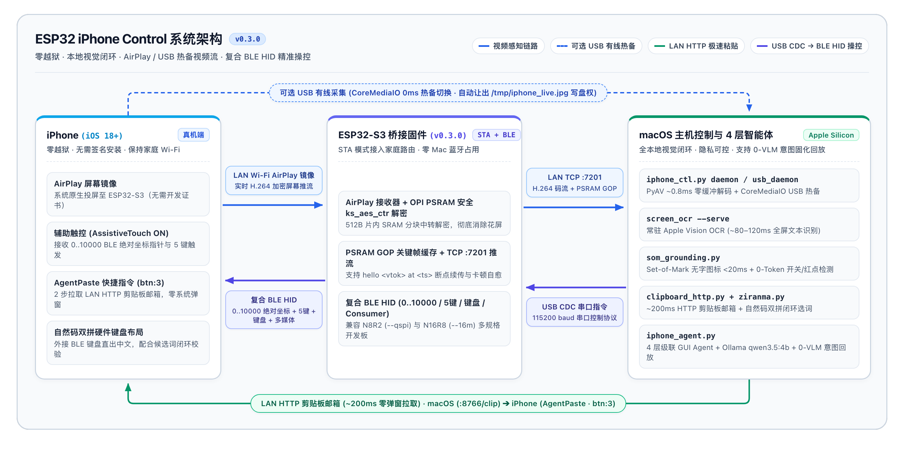

# ESP32 iPhone Control

简体中文 · [English](README.en.md)

<p>
  <a href="LICENSE"></a>
  
  
  
  
</p>

**ESP32 iPhone Control** 是一套运行于 macOS 主机与 ESP32-S3 硬件桥接器之间的本地视觉闭环 iPhone 自动化控制系统。无需越狱，无需在 iPhone 上签名或安装任何自研 App，即可通过局域网 AirPlay（或 USB 有线采集）实时感知屏幕画面，并经由复合 BLE HID 精准操控真机。

---

## 核心优势

- **零越狱、零 iOS 侧 App 安装**：iPhone 仅需系统自带的「屏幕镜像（AirPlay）」与「辅助触控（AssistiveTouch）」，无需 Xcode 签名、TestFlight 或开发者证书。
- **iPhone 保持正常家庭 Wi-Fi 联网**：ESP32-S3 以 STA 模式（`--sta`）接入现有家庭路由器，iPhone 全程正常上网，不再依赖无外网的孤立热点，也无需占用 iPhone 物理 Lightning / USB-C 接口。
- **Mac 端零蓝牙占用**：BLE 链路完全由 ESP32-S3 独立承担（复合鼠标 + 键盘 + Consumer 媒体控制），不干扰 macOS 本机蓝牙外设。
- **毫秒级本地视觉闭环**：Mac 主机完成 PyAV 零缓冲解码（`~0.8ms`）、常驻 Apple Vision OCR（`~80–120ms`）、Set-of-Mark 无文字图标接地（`<20ms`）以及 Ollama 本地多模态决策（`qwen3.5:4b`），全链路隐私可控。

---

## 系统架构

<p align="center">
  
</p>

---

## 六大核心技术特性（v0.3.0）

### 1. `0..10000` 7 字节 BLE 绝对坐标鼠标 + 5 键扩展 + Consumer 控制
- **7 字节绝对坐标指针（Report ID 3）**：支持 `0..10000` 全局映射坐标（`abstap` / `absswipe` / `target ... abs=1`），消除传统相对移动的多步累积漂移。
- **双点自动校准与极速点击**：`calibrate_abs` 探测 `(0.20, 0.20)` 与 `(0.80, 0.80)` 两点并拟合线性边界存入 `iphone_calibration.json`，实现 **±3px 开环精度**与 **~210ms 单次点击**。
- **5 键鼠标 + Consumer 扩展（Report ID 2）**：支持 `click 1..5`（可用于触发辅助触控绑定的快捷指令）、`0x00B8` 软键盘切换（`kbd_toggle`）、`0x0030` 电源键（`power`）、`0x0221` Spotlight 键及 `CapsLock`。
- **向后兼容 `0.2.x` 固件**：自动检测固件 `abs` 能力（可通过 `IPHONE_FORCE_REL=1` 强制回退），旧版固件无缝切换至 3 帧指针定位与 12 点在线回归相对闭环控制。

### 2. 自愈式 AirPlay `:7201` 零缓冲解码 + CoreMediaIO USB 有线热备
- **OPI PSRAM `ks_aes_ctr` 分块解密零花屏修复**：在 `hardware/hid_bridge/src/airplay/keystream.c` 中，将 AES-CTR 解密缓冲先拷贝至 512 字节片内 SRAM 栈缓冲再调用 `mbedtls_aes_crypt_ctr`，彻底解决 ESP32-S3 OPI PSRAM 指针直解密导致的花屏与关键帧损坏问题。
- **进程内 PyAV 零缓冲解码**：通过 `libavcodec` SLICE 多线程直接将 TCP `:7201` H.264 帧原子写入 `/tmp/iphone_live.jpg`（`~0.8ms/帧`），同时支持 `hello <vtok> at <ts>` GOP 断点续传与 `vdbg`/`vage` 卡顿自愈。
- **CoreMediaIO USB 有线热备（`usb_capture.swift`）**：运行 `python3 iphone_ctl.py usb_daemon` 后，系统自动按 `720px` 宽等比采集有线画面并写入 `/tmp/iphone_usb_capture.json` 心跳；期间 AirPlay `daemon` 保持后台热待命并让出写盘权，拔线即可 0ms 无缝回切无线镜像。

### 3. 常驻 Apple Vision OCR + Set-of-Mark 无文字图标接地 + 零 Token 像素检测
- **常驻 Vision OCR（`screen_ocr --serve`）**：将 `VNRecognizeTextRequest`（`zh-Hans` / `zh-Hant` / `en-US`，`.accurate` 模式）常驻内存，单帧识别耗时仅 **~80–120ms**（相较冷启动 `~750ms` 提速 6 倍以上）。
- **Set-of-Mark 视觉接地（`som_grounding.py`）**：基于 Pillow 边缘梯度聚类的纯本地检测器（`<20ms`），自动过滤状态栏、Home 指示条与已有 OCR 文本框，为返回 `<`、关闭 `×`、搜索 🔍、加号 `+`、齿轮 ⚙️ 等无文字图标叠加 `[#ID]` 红色编号胶囊，让本地 VLM 可直接通过 `tap_ocr` 精准点击图标。
- **零 Token 确定性像素检测**：`detect_ios_switches`（`~8ms`）通过 `#34C759` 绿色轨道与滑块几何自动判定设置项开关 ON/OFF；`detect_red_badges`（`~25–45ms`）通过 `NEAREST` 采样连通域识别未读红点与数字角标并绑定至应用或标签。

### 4. `~200ms` 零弹窗 HTTP 剪贴板信箱 + 自然码双拼闭环输入法
- **局域网 HTTP 剪贴板信箱（`clipboard_http.py`）**：内置线程安全的 `ClipboardMailboxServer`（提供 `GET /clip`、`GET /setup`、`GET /health` 与仅限本机的 `POST /clip`），配合 iPhone 端 2 步快捷指令 `AgentPaste`（通过辅助触控 `btn:3` 触发），在 **~200ms** 内无系统弹窗地投递长文本、多行段落、URL 与 Emoji；支持 `clip_serve` 独立跨进程代理投递，以及 `pbcopy` / 自然码双拼自动兜底。
- **自然码双拼闭环候选词校验（`ziranma.py`）**：调用 macOS CoreFoundation `CFStringTokenizer` + `CFStringTransform("Han-Latin")` 进行上下文分词与多音字消歧，编码为自然码双拼键序，并实时截取 iOS 浮动候选栏（`92px` 横带）进行 OCR 槽位校验与翻页选词（如 `uivs` 准确选中「时钟」而非「始终」）。

### 5. 4 层级联本地 GUI 智能体 + 防死循环熔断 + 零 VLM 意图固化回放
- **4 层级联执行（`iphone_agent.py`）**：
  - **Tier 1**：常驻 Apple Vision OCR 全屏感知（`~80–120ms`）
  - **Tier 2**：直达文本/坐标 BLE HID 点击与 Set-of-Mark 图标点击（0 VLM Token）
  - **Tier 2.5**：`UISwitch` 开关状态与红点角标像素级事实注入（0 VLM Token）
  - **Tier 3 / 4**：基于 Ollama `qwen3.5:4b` 的接地 VLM 规划循环，支持 `tap_ocr`、`tap_and_type`、`type_smart`、`scroll_screen`、`open_app` 与云端升级 `escalate`。
- **3 步防死循环熔断 & `confirm` 安全门禁**：连续 3 步 `frames_changed` 无变化自动触发 `esc` 清理遮罩并熔断上报；遇到付款、发送消息、删除数据或权限确认前强制返回 `confirm` 等待人工确认。
- **零 VLM 意图固化回放（`save_intent` / `run_intent`）**：将成功执行的 `run_goal` 轨迹提炼至 `iphone_intents.json`，后续以 `~0.8–1.5s/步` 零 VLM 极速回放；一旦遇到意外弹窗或页面偏移，自动无缝移交回实时 VLM `run_goal` 接管。

### 6. 多规格 ESP32-S3 开发板支持
- **默认配置**：8MB Flash + 8MB OPI PSRAM（如 Seeed Studio XIAO ESP32S3）。
- **`--qspi`**：适配 `ESP32-S3-WROOM-1 N8R2 / N4R2`（2MB Quad PSRAM，动态缩放 PSRAM GOP/尾帧缓冲）。
- **`--16m`**：适配 `ESP32-S3 N16R8`（16MB Flash + 8MB OPI PSRAM）。

---

## 快速开始（macOS + ESP32-S3）

### 1. 烧录 ESP32-S3 固件

复制并编辑 Wi-Fi 凭据文件（`secrets.h` 已被 `.gitignore` 忽略）：

```bash
cp hardware/hid_bridge/secrets.example.h hardware/hid_bridge/secrets.h
# 编辑 hardware/hid_bridge/secrets.h，填入你的家庭 Wi-Fi SSID 与密码
```

安装依赖库并按你的开发板型号编译烧录：

```bash
arduino-cli core update-index --additional-urls https://espressif.github.io/arduino-esp32/package_esp32_index.json
arduino-cli core install esp32:esp32@3.3.12 --additional-urls https://espressif.github.io/arduino-esp32/package_esp32_index.json
arduino-cli lib install "NimBLE-Arduino@2.5.1"

# 默认（Seeed XIAO ESP32S3，8MB Flash + 8MB OPI PSRAM）：
hardware/flash.sh --sta

# ESP32-S3-WROOM-1 N8R2（2MB QSPI PSRAM）：
hardware/flash.sh --sta --qspi

# ESP32-S3 N16R8（16MB Flash + 8MB OPI PSRAM）：
hardware/flash.sh --sta --16m
```

**iPhone 端配对与设置（iOS 18+）：**
1. 打开 **设置 → 蓝牙**，配对名为 **`ESP32 Agent XXXX`** 的设备（`XXXX` 为板载后缀）。
2. 打开 **设置 → 辅助功能 → 触控 → 辅助触控**，开启 **辅助触控**。
3. 如需使用自然码双拼输入（`type_zh`），请确认外接硬件键盘的中文拼音布局设置为 **自然码双拼**。
4. 下拉 **控制中心 → 屏幕镜像**，选择 **`ESP32 Agent`** 开始投屏。

### 2. 编译 macOS 原生 Swift 组件

```bash
swiftc -O screen_ocr.swift -o screen_ocr
swiftc -O usb_capture.swift -o usb_capture   # 可选：CoreMediaIO USB 有线画面采集守护进程
swiftc -O vt_decoder.swift -o vt_decoder     # 可选：独立 VideoToolbox H.264 硬件解码器
```

### 3. 安装 Python 依赖与配置 `.env`

```bash
pip install pyserial av Pillow
cp .env.example .env
```

如需运行 Tier 3 本地视觉智能体，请安装并拉取 Ollama 模型：

```bash
ollama pull qwen3.5:4b
```

`.env` 核心配置参数说明（由 `iphone_ctl.py` 与 `iphone_agent.py` 自动加载，无需第三方 dotenv 库）：

| 变量名 | 默认值 | 说明 |
| :--- | :--- | :--- |
| `ESP32_SERIAL_PORT` | 自动探测 `/dev/cu.usbmodem*` | 显式固定 ESP32-S3 USB CDC 串口路径 |
| `OLLAMA_API_URL` | `http://127.0.0.1:11434/api/chat` | 本地或局域网 Ollama Chat API 地址 |
| `OLLAMA_MODEL` | `qwen3.5:4b` | Tier 3 多模态视觉决策模型名称 |
| `IPHONE_CLIP_PORT` | `8766` | 本地 HTTP 剪贴板信箱监听端口 |
| `IPHONE_PASTE_TRIGGER` | `btn:3` | 触发 `AgentPaste` 的 HID 动作（`btn:2..5`、`key:ctrl+alt+v` 或 `pbcopy`） |

### 4. 启动视频流与剪贴板守护进程

```bash
# 检查串口、BLE HID 与固件状态
python3 iphone_ctl.py status

# 启动 AirPlay TCP :7201 零缓冲视频流守护进程（持续更新 /tmp/iphone_live.jpg）
python3 iphone_ctl.py daemon

# 启动独立 HTTP 剪贴板信箱服务（供跨进程 paste / 智能体长文本粘贴使用）
python3 iphone_ctl.py clip_serve

# 可选：启动 CoreMediaIO USB 有线采集守护进程（激活时自动接管 /tmp/iphone_live.jpg）
python3 iphone_ctl.py usb_daemon
```

**iPhone 端 `AgentPaste` 3 步配置：**
启动 `clip_serve` 后，用 iPhone Safari 访问终端输出的 setup 地址 `http://<Mac_IP>:8766/setup`：
1. 在 iPhone「快捷指令」App 中新建名为 **`AgentPaste`** 的快捷指令，仅需 2 个动作：**获取 URL 内容**（填入页面显示的 `http://<Mac_IP>:8766/clip`）→ **拷贝至剪贴板**（展开选项并开启 **仅限本地**）。
2. 打开 **设置 → 辅助功能 → 触控 → 辅助触控 → 设备**，选中已连接的 ESP32 鼠标，将 **按钮 3** 绑定为 **`AgentPaste`**（对应 `IPHONE_PASTE_TRIGGER=btn:3`）。
3. 手动运行一次该快捷指令，授权 iOS 允许访问本地网络即可。

### 5. 常用命令与智能体任务示例

```bash
# 首次使用绝对坐标模式建议执行双点自动校准（保存至 iphone_calibration.json）
python3 iphone_ctl.py calibrate_abs

# 底层控制器命令（0 VLM Token）
python3 iphone_ctl.py screenshot /tmp/snap.jpg
python3 iphone_ctl.py abstap 0.50 0.52
python3 iphone_ctl.py tap_aim 360 800
python3 iphone_ctl.py spotlight 备忘录
python3 iphone_ctl.py paste "长文本 + Emoji 🚀🎉 支持局域网 HTTP 剪贴板零弹窗极速粘贴！"
python3 iphone_ctl.py type_zh "自然码双拼闭环候选词校验测试通过"
python3 iphone_ctl.py kbd_toggle
python3 iphone_ctl.py home

# 4 层本地 GUI 智能体任务
python3 iphone_agent.py ocr
python3 iphone_agent.py tap_text "无线局域网"
python3 iphone_agent.py goal "打开设置，进入蓝牙页面并汇报当前蓝牙开关状态"

# 意图固化保存与零 VLM 极速回放
python3 iphone_agent.py intent_save check_bluetooth
python3 iphone_agent.py intent_run check_bluetooth
```

---

## 仓库目录结构与测试

```text
iphone_ctl.py       USB 串口桥接、自愈式 TCP :7201 PyAV 流守护进程、0..10000 BLE 指针与自然码输入
iphone_agent.py     4 层级联 GUI 智能体（常驻 OCR、Set-of-Mark 图标、UISwitch/红点检测、Ollama VLM）
clipboard_http.py   本地 HTTP 剪贴板信箱服务端（/clip, /setup, /health）
som_grounding.py    纯 Python + Pillow Set-of-Mark 无文字图标检测与标注渲染器
ziranma.py          零外部依赖 macOS CoreFoundation 中文分词与自然码双拼编码器
screen_ocr.swift    原生 Apple Vision OCR 工具与常驻 `--serve` JSON 管道服务
usb_capture.swift   原生 CoreMediaIO + AVFoundation USB iPhone 有线屏幕采集守护进程
vt_decoder.swift    可选 macOS VideoToolbox 硬件 H.264 -> JPEG 解码器
tests/              离线单元测试套件（Stage 1 绝对坐标、Stage 2 HTTP 剪贴板、Stage 3 SoM & USB 采集）
hardware/           ESP32-S3 固件（AirPlay 接收端、复合 BLE/USB HID、GOP 视频转发、硬件宿主 C 测试）
assets/             中英文系统架构图（`architecture-zh.png`、`architecture-en.png`）
.env.example        串口、Ollama 接口与 HTTP 剪贴板配置模板
```

运行离线测试套件（无需连接真实硬件）：

```bash
# Python 主机端单元测试
python3 -m unittest discover -s tests -v

# ESP32 固件纯 C 核心模块测试（需安装 mbedtls 3.x）
make -C hardware/tests test
```

---

## 开源协议与致谢（License & Acknowledgments）

- **主体许可**：本仓库主体主机端代码、智能体框架与新增扩展采用 **MIT License** 开源（`Copyright (c) 2026 jlcbk`），完整协议见 [`LICENSE`](LICENSE) 与 [`NOTICE`](NOTICE)。
- **上游合规署名**：`Based on [ESP32 iPhone Agent](https://github.com/onehumanbeing/esp32-iphone-agent) by Henry Yuan.`
  `hardware/` 下的底层 ESP32 AirPlay 接收端与 BLE/USB HID 桥接固件基于 Henry Yuan 的 **[ESP32 iPhone Agent](https://github.com/onehumanbeing/esp32-iphone-agent)** 改造与扩展（`Copyright (c) 2026 Henry Yuan`，MIT License）。任何复制、二次分发或基于本项目的公开演示、视频与文章，请按 MIT 协议要求保留版权声明并显著署名上游项目。
- **GPL-3.0 组件声明**：`hardware/hid_bridge/src/airplay/` 目录下的 AirPlay 镜像解码模块源自 [UxPlay](https://github.com/FDH2/UxPlay)，遵循 **GPL-3.0** 协议（详见 [`hardware/hid_bridge/src/airplay/LICENSE-GPL.md`](hardware/hid_bridge/src/airplay/LICENSE-GPL.md)），链接该模块编译生成的固件二进制文件按 GPL-3.0 分发。
